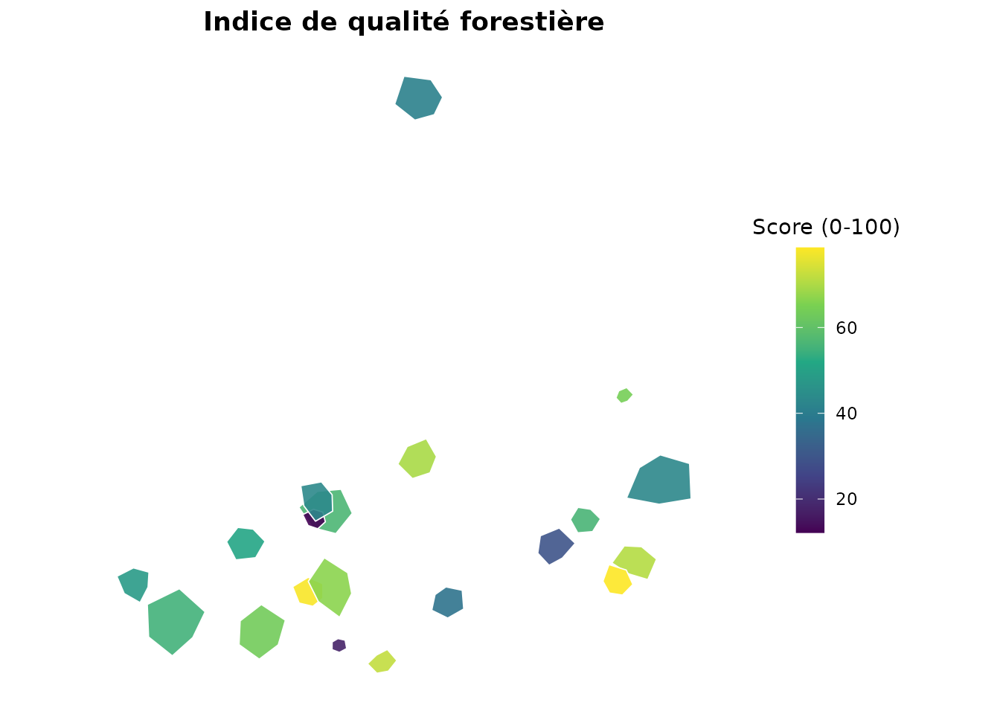

# Démarrage rapide avec nemeton

## Introduction

Le package `nemeton` implémente la méthode Nemeton pour l’analyse
systémique de territoires forestiers. Il fournit des outils pour :

- Calculer des indicateurs biophysiques multi-famille (carbone, eau,
  sols, paysage, etc.)
- Normaliser les valeurs d’indicateurs selon plusieurs méthodes
- Créer des indices composites pour une évaluation holistique
- Visualiser les résultats avec des cartes et graphiques

Cette vignette démontre le workflow complet avec le jeu de données
`massif_demo`.

## Installation

``` r

# Depuis GitHub
remotes::install_github("pobsteta/nemeton")
```

``` r

library(nemeton)
library(ggplot2)
```

## Charger les données de démonstration

Le package inclut un jeu de données synthétique (`massif_demo`)
représentant une zone de 5km × 5km avec 20 parcelles forestières.

``` r

# Charger les parcelles forestières
data(massif_demo_units)

# Inspecter les parcelles
print(massif_demo_units)
#> Simple feature collection with 20 features and 131 fields
#> Geometry type: POLYGON
#> Dimension:     XY
#> Bounding box:  xmin: 698041.8 ymin: 6499215 xmax: 702793.8 ymax: 6504159
#> Projected CRS: RGF93 v1 / Lambert-93
#> First 10 features:
#>    parcel_id      forest_type age_class   management species age
#> 1        P01     Futaie mixte    Mature        Mixte      09  68
#> 2        P02 Futaie résineuse     Moyen   Production      64  33
#> 3        P03  Futaie feuillue  Surannée Conservation      03 104
#> 4        P04  Futaie feuillue  Surannée   Production      03 166
#> 5        P05 Futaie résineuse     Moyen   Production      61  47
#> 6        P06 Futaie résineuse    Mature   Production      61  79
#> 7        P07  Futaie feuillue    Mature        Mixte      03  75
#> 8        P08  Futaie feuillue    Mature   Production      52  71
#> 9        P09     Futaie mixte     Moyen   Production      03  48
#> 10       P10          Taillis  Surannée   Production      52 165
#>    establishment_year density height  dbh volume strata fertility     climate
#> 1                1958     266   30.3 45.8  557.7      4         1 continental
#> 2                1993     465   30.4 57.5 1541.7      1         3  atlantique
#> 3                1922     128   31.7 41.7  232.7      2         2  atlantique
#> 4                1860     104   29.9 42.6  186.1      2         1  atlantique
#> 5                1979     324   27.5 51.5  779.5      2         2  atlantique
#> 6                1947     281   38.6 76.1 2072.1      2         1  atlantique
#> 7                1951     184   33.9 47.1  456.5      2         3 continental
#> 8                1955     169   27.2 38.8  228.3      3         2  montagnard
#> 9                1978     369   24.8 34.0  349.0      4         3  atlantique
#> 10               1861     632   25.7 34.0  619.4      2         2  montagnard
#>    surface_ha couvert        C1 C2 B1 B2  B3 B4 B5       W1 W2       W3 W4
#> 1    4.989211    0.90  49.01124 NA NA NA 100 NA NA 0.000000  0 2.172398 NA
#> 2    5.867935    0.75  17.78697 NA NA NA 100 NA NA 0.000000  0 2.079708 NA
#> 3    6.557777    0.77  70.53634 NA NA NA 100 NA NA 0.000000  0 2.320038 NA
#> 4    9.989553    0.86 134.98574 NA NA NA 100 NA NA 8.677353  0 2.179088 NA
#> 5    5.906395    0.82  29.20340 NA NA NA 100 NA NA 0.000000  0 2.243098 NA
#> 6    1.048296    0.87  56.77781 NA NA NA 100 NA NA 0.000000  0 2.081669 NA
#> 7   17.079363    0.90  55.01833 NA NA NA 100 NA NA 0.000000  0 2.192747 NA
#> 8   11.414577    0.76  44.44292 NA NA NA 100 NA NA 0.000000  0 2.238672 NA
#> 9   16.105209    0.83  30.25904 NA NA NA 100 NA NA 0.000000  0 2.244686 NA
#> 10  10.733433    0.75 118.81922 NA NA NA 100 NA NA 3.771602  0 2.261767 NA
#>           A1    A2 A3 A4 A5 F1   F2   L1   L2 L3  T1 T2 T3 T4        R1
#> 1   99.86906 100.0 NA NA NA NA 15.0 52.4 91.8 NA  68 NA NA NA  99.92593
#> 2   99.97049  99.4 NA NA NA NA 10.3 52.6 93.0 NA  33 NA NA NA 100.00000
#> 3  100.00000  99.5 NA NA NA NA 14.9 51.3 91.2 NA 104 NA NA NA 100.00000
#> 4   99.84681  98.6 NA NA NA NA 13.7 51.5 94.5 NA 166 NA NA NA  99.89067
#> 5   99.77814  99.9 NA NA NA NA 13.1 51.2 94.6 NA  47 NA NA NA  99.52389
#> 6   99.76134  99.9 NA NA NA NA 11.1 51.0 94.6 NA  79 NA NA NA  99.93789
#> 7   99.73619 100.0 NA NA NA NA 12.9 53.0 93.5 NA  75 NA NA NA  99.98671
#> 8   99.73794 100.0 NA NA NA NA 15.0 52.8 94.2 NA  71 NA NA NA  99.68795
#> 9  100.00000  95.3 NA NA NA NA 15.2 50.3 90.7 NA  48 NA NA NA  99.89949
#> 10  99.76902  99.8 NA NA NA NA 15.0 51.5 93.8 NA 165 NA NA NA  99.93098
#>          R2       R3 R4 R5 R6 R7        S1 S2 S3        P1  P2  P3       E1
#> 1  35.25631 76.92404 NA NA NA NA 2000.0000 NA NA  625.5427  NA 100 2.074644
#> 2  41.96851 75.30786 NA NA NA NA  519.1841 NA NA 1916.2231  NA 100 5.735124
#> 3  34.54891 73.28855 NA NA NA NA  613.0613 NA NA  261.0616 6.5 100 0.865644
#> 4  35.61949 76.75013 NA NA NA NA  315.2487 NA NA  208.7976  NA 100 0.692292
#> 5  35.99775 74.29972 NA NA NA NA 1567.7493 NA NA  968.8934 6.5 100 2.899740
#> 6  35.12141 76.35914 NA NA NA NA 1231.9158 NA NA 2575.4125  NA 100 7.708212
#> 7  35.78224 74.47584 NA NA NA NA 2000.0000 NA NA  511.9895  NA 100 1.698180
#> 8  32.92514 75.01452 NA NA NA NA 1760.8281 NA NA  283.7285 6.5 100 0.849276
#> 9  33.02696 74.15969 NA NA NA NA  167.4920 NA NA  391.4151  NA  85 1.298280
#> 10 35.28078 74.08264 NA NA NA NA 1028.0662 NA NA  769.8248 6.5 100 2.304168
#>           E2 N1       N2 N3 N5           b4_status        b5_status
#> 1  2.0725694 NA 60.00000 NA NA skipped_no_spectral skipped_no_lidar
#> 2  5.7293889 NA 60.00000 NA NA skipped_no_spectral skipped_no_lidar
#> 3  0.8647784 NA 60.00000 NA NA skipped_no_spectral skipped_no_lidar
#> 4  0.6915997 NA 60.00000 NA NA skipped_no_spectral skipped_no_lidar
#> 5  2.8968403 NA 60.00000 NA NA skipped_no_spectral skipped_no_lidar
#> 6  7.7005038 NA 60.00000 NA NA skipped_no_spectral skipped_no_lidar
#> 7  1.6964818 NA 60.00000 NA NA skipped_no_spectral skipped_no_lidar
#> 8  0.8484267 NA 59.49461 NA NA skipped_no_spectral skipped_no_lidar
#> 9  1.2969817 NA 60.00000 NA NA skipped_no_spectral skipped_no_lidar
#> 10 2.3018638 NA 60.00000 NA NA skipped_no_spectral skipped_no_lidar
#>           w4_status        a3_status        a4_status      a5_status
#> 1  skipped_no_micro skipped_no_micro skipped_no_micro skipped_no_lst
#> 2  skipped_no_micro skipped_no_micro skipped_no_micro skipped_no_lst
#> 3  skipped_no_micro skipped_no_micro skipped_no_micro skipped_no_lst
#> 4  skipped_no_micro skipped_no_micro skipped_no_micro skipped_no_lst
#> 5  skipped_no_micro skipped_no_micro skipped_no_micro skipped_no_lst
#> 6  skipped_no_micro skipped_no_micro skipped_no_micro skipped_no_lst
#> 7  skipped_no_micro skipped_no_micro skipped_no_micro skipped_no_lst
#> 8  skipped_no_micro skipped_no_micro skipped_no_micro skipped_no_lst
#> 9  skipped_no_micro skipped_no_micro skipped_no_micro skipped_no_lst
#> 10 skipped_no_micro skipped_no_micro skipped_no_micro skipped_no_lst
#>              l3_status          t3_status          t4_status r1_status
#> 1  skipped_no_spectral skipped_no_sufosat skipped_no_forms_t  fire_exp
#> 2  skipped_no_spectral skipped_no_sufosat skipped_no_forms_t  fire_exp
#> 3  skipped_no_spectral skipped_no_sufosat skipped_no_forms_t  fire_exp
#> 4  skipped_no_spectral skipped_no_sufosat skipped_no_forms_t  fire_exp
#> 5  skipped_no_spectral skipped_no_sufosat skipped_no_forms_t  fire_exp
#> 6  skipped_no_spectral skipped_no_sufosat skipped_no_forms_t  fire_exp
#> 7  skipped_no_spectral skipped_no_sufosat skipped_no_forms_t  fire_exp
#> 8  skipped_no_spectral skipped_no_sufosat skipped_no_forms_t  fire_exp
#> 9  skipped_no_spectral skipped_no_sufosat skipped_no_forms_t  fire_exp
#> 10 skipped_no_spectral skipped_no_sufosat skipped_no_forms_t  fire_exp
#>            r5_status        r6_status       r7_status     p3_status
#> 1  skipped_no_method skipped_no_micro skipped_no_tmin diametre_seul
#> 2  skipped_no_method skipped_no_micro skipped_no_tmin diametre_seul
#> 3  skipped_no_method skipped_no_micro skipped_no_tmin diametre_seul
#> 4  skipped_no_method skipped_no_micro skipped_no_tmin diametre_seul
#> 5  skipped_no_method skipped_no_micro skipped_no_tmin diametre_seul
#> 6  skipped_no_method skipped_no_micro skipped_no_tmin diametre_seul
#> 7  skipped_no_method skipped_no_micro skipped_no_tmin diametre_seul
#> 8  skipped_no_method skipped_no_micro skipped_no_tmin diametre_seul
#> 9  skipped_no_method skipped_no_micro skipped_no_tmin diametre_seul
#> 10 skipped_no_method skipped_no_micro skipped_no_tmin diametre_seul
#>               n5_status  C1_norm C2_norm B1_norm B2_norm B3_norm B4_norm
#> 1  skipped_no_embedding 32.67416      NA      NA      NA     100      NA
#> 2  skipped_no_embedding 11.85798      NA      NA      NA     100      NA
#> 3  skipped_no_embedding 47.02422      NA      NA      NA     100      NA
#> 4  skipped_no_embedding 89.99050      NA      NA      NA     100      NA
#> 5  skipped_no_embedding 19.46893      NA      NA      NA     100      NA
#> 6  skipped_no_embedding 37.85187      NA      NA      NA     100      NA
#> 7  skipped_no_embedding 36.67889      NA      NA      NA     100      NA
#> 8  skipped_no_embedding 29.62861      NA      NA      NA     100      NA
#> 9  skipped_no_embedding 20.17269      NA      NA      NA     100      NA
#> 10 skipped_no_embedding 79.21281      NA      NA      NA     100      NA
#>    B5_norm   W1_norm W2_norm W3_norm W4_norm   A1_norm A2_norm A3_norm A4_norm
#> 1       NA  0.000000       0       0      NA  99.86906   100.0      NA      NA
#> 2       NA  0.000000       0       0      NA  99.97049    99.4      NA      NA
#> 3       NA  0.000000       0       0      NA 100.00000    99.5      NA      NA
#> 4       NA 17.354705       0       0      NA  99.84681    98.6      NA      NA
#> 5       NA  0.000000       0       0      NA  99.77814    99.9      NA      NA
#> 6       NA  0.000000       0       0      NA  99.76134    99.9      NA      NA
#> 7       NA  0.000000       0       0      NA  99.73619   100.0      NA      NA
#> 8       NA  0.000000       0       0      NA  99.73794   100.0      NA      NA
#> 9       NA  0.000000       0       0      NA 100.00000    95.3      NA      NA
#> 10      NA  7.543203       0       0      NA  99.76902    99.8      NA      NA
#>    A5_norm F1_norm F2_norm L1_norm L2_norm L3_norm T1_norm T2_norm T3_norm
#> 1       NA      NA    15.0    47.6    91.8      NA    34.0      NA      NA
#> 2       NA      NA    10.3    47.4    93.0      NA    16.5      NA      NA
#> 3       NA      NA    14.9    48.7    91.2      NA    52.0      NA      NA
#> 4       NA      NA    13.7    48.5    94.5      NA    83.0      NA      NA
#> 5       NA      NA    13.1    48.8    94.6      NA    23.5      NA      NA
#> 6       NA      NA    11.1    49.0    94.6      NA    39.5      NA      NA
#> 7       NA      NA    12.9    47.0    93.5      NA    37.5      NA      NA
#> 8       NA      NA    15.0    47.2    94.2      NA    35.5      NA      NA
#> 9       NA      NA    15.2    49.7    90.7      NA    24.0      NA      NA
#> 10      NA      NA    15.0    48.5    93.8      NA    82.5      NA      NA
#>    T4_norm      R1_norm  R2_norm  R3_norm R4_norm R5_norm R6_norm R7_norm
#> 1       NA 7.406871e-02 64.74369 23.07596      NA      NA      NA      NA
#> 2       NA 1.421085e-14 58.03149 24.69214      NA      NA      NA      NA
#> 3       NA 1.421085e-14 65.45109 26.71145      NA      NA      NA      NA
#> 4       NA 1.093308e-01 64.38051 23.24987      NA      NA      NA      NA
#> 5       NA 4.761100e-01 64.00225 25.70028      NA      NA      NA      NA
#> 6       NA 6.211201e-02 64.87859 23.64086      NA      NA      NA      NA
#> 7       NA 1.328786e-02 64.21776 25.52416      NA      NA      NA      NA
#> 8       NA 3.120502e-01 67.07486 24.98548      NA      NA      NA      NA
#> 9       NA 1.005133e-01 66.97304 25.84031      NA      NA      NA      NA
#> 10      NA 6.901821e-02 64.71922 25.91736      NA      NA      NA      NA
#>     S1_norm S2_norm S3_norm   P1_norm  P2_norm P3_norm   E1_norm   E2_norm
#> 1   0.00000      NA      NA  78.19283       NA     100  78.58500  78.50642
#> 2  74.04080      NA      NA 100.00000       NA     100 100.00000 100.00000
#> 3  69.34694      NA      NA  32.63271 43.33333     100  32.78955  32.75676
#> 4  84.23757      NA      NA  26.09970       NA     100  26.22318  26.19696
#> 5  21.61254      NA      NA 100.00000 43.33333     100 100.00000 100.00000
#> 6  38.40421      NA      NA 100.00000       NA     100 100.00000 100.00000
#> 7   0.00000      NA      NA  63.99869       NA     100  64.32500  64.26068
#> 8  11.95859      NA      NA  35.46606 43.33333     100  32.16955  32.13738
#> 9  91.62540      NA      NA  48.92689       NA      85  49.17727  49.12810
#> 10 48.59669      NA      NA  96.22810 43.33333     100  87.27909  87.19181
#>    N1_norm  N2_norm N3_norm N5_norm famille_carbone famille_biodiversite
#> 1       NA 60.00000      NA      NA        32.67416                  100
#> 2       NA 60.00000      NA      NA        11.85798                  100
#> 3       NA 60.00000      NA      NA        47.02422                  100
#> 4       NA 60.00000      NA      NA        89.99050                  100
#> 5       NA 60.00000      NA      NA        19.46893                  100
#> 6       NA 60.00000      NA      NA        37.85187                  100
#> 7       NA 60.00000      NA      NA        36.67889                  100
#> 8       NA 59.49461      NA      NA        29.62861                  100
#> 9       NA 60.00000      NA      NA        20.17269                  100
#> 10      NA 60.00000      NA      NA        79.21281                  100
#>    famille_eau famille_air famille_sol famille_paysage famille_temporel
#> 1     0.000000    99.93453        15.0           69.70             34.0
#> 2     0.000000    99.68525        10.3           70.20             16.5
#> 3     0.000000    99.75000        14.9           69.95             52.0
#> 4     5.784902    99.22340        13.7           71.50             83.0
#> 5     0.000000    99.83907        13.1           71.70             23.5
#> 6     0.000000    99.83067        11.1           71.80             39.5
#> 7     0.000000    99.86809        12.9           70.25             37.5
#> 8     0.000000    99.86897        15.0           70.70             35.5
#> 9     0.000000    97.65000        15.2           70.20             24.0
#> 10    2.514401    99.78451        15.0           71.15             82.5
#>    famille_risque famille_social famille_production famille_energie
#> 1        29.29790        0.00000           89.09642        78.54571
#> 2        27.57454       74.04080          100.00000       100.00000
#> 3        30.72085       69.34694           58.65535        32.77315
#> 4        29.24657       84.23757           63.04985        26.21007
#> 5        30.05955       21.61254           81.11111       100.00000
#> 6        29.52719       38.40421          100.00000       100.00000
#> 7        29.91840        0.00000           81.99934        64.29284
#> 8        30.79080       11.95859           59.59980        32.15346
#> 9        30.97129       91.62540           66.96345        49.15268
#> 10       30.23520       48.59669           79.85381        87.23545
#>    famille_naturalite                       geometry
#> 1            60.00000 POLYGON ((698299.9 6499928,...
#> 2            60.00000 POLYGON ((701702.2 6500418,...
#> 3            60.00000 POLYGON ((702240.4 6500270,...
#> 4            60.00000 POLYGON ((700641.3 6504129,...
#> 5            60.00000 POLYGON ((699268.2 6500307,...
#> 6            60.00000 POLYGON ((699943.5 6499421,...
#> 7            60.00000 POLYGON ((698500.5 6499360,...
#> 8            59.49461 POLYGON ((699061.9 6499649,...
#> 9            60.00000 POLYGON ((702258.5 6500666,...
#> 10           60.00000 POLYGON ((699897.1 6500739,...

# Statistiques sommaires
cat("\nSurface totale:", sum(massif_demo_units$surface_ha), "ha\n")
#> 
#> Surface totale: 136.0225 ha
table(massif_demo_units$forest_type)
#> 
#>  Futaie feuillue     Futaie mixte Futaie résineuse          Taillis 
#>               11                2                4                3
```

``` r

ggplot(massif_demo_units) +
  geom_sf(aes(fill = forest_type)) +
  theme_minimal() +
  labs(
    title = "Massif Demo - Types forestiers",
    fill = "Type de forêt"
  )
```


Parcelles forestières par type

## Charger les couches spatiales

Utilisez
[`massif_demo_layers()`](https://pobsteta.github.io/nemeton/reference/massif_demo_layers.md)
pour charger tous les rasters et vecteurs associés :

``` r

layers <- massif_demo_layers()
print(layers)
#> 
#> ── nemeton_layers object ───────
#> 
#> ── Rasters (4) ──
#> 
#> • biomass : massif_demo_biomass.tif [not loaded] 
#> • dem : massif_demo_dem.tif [not loaded] 
#> • landcover : massif_demo_landcover.tif [not loaded] 
#> • species_richness : massif_demo_species_richness.tif [not loaded] 
#> 
#> ── Vectors (2) ──
#> 
#> • roads : massif_demo_roads.gpkg [not loaded] 
#> • water : massif_demo_water.gpkg [not loaded]
```

Le jeu de données inclut : - **Rasters** : biomasse, MNT, occupation du
sol, richesse spécifique - **Vecteurs** : réseau routier, cours d’eau

## Calculer les indicateurs

### Indicateurs individuels

``` r

# Carbone (via NDVI)
carbon <- nemeton_compute(
  massif_demo_units,
  layers,
  indicators = "indicateur_c2_ndvi"
)

# Eau (TWI - Topographic Wetness Index)
water <- nemeton_compute(
  massif_demo_units,
  layers,
  indicators = "indicateur_w3_humidite"
)

# Afficher les résultats
head(carbon[, c("parcel_id", "forest_type", "indicateur_c2_ndvi")])
#> Simple feature collection with 6 features and 3 fields
#> Geometry type: POLYGON
#> Dimension:     XY
#> Bounding box:  xmin: 698041.8 ymin: 6499388 xmax: 702507.7 ymax: 6504159
#> Projected CRS: RGF93 v1 / Lambert-93
#>   parcel_id      forest_type indicateur_c2_ndvi                       geometry
#> 1       P01     Futaie mixte                 NA POLYGON ((698299.9 6499928,...
#> 2       P02 Futaie résineuse                 NA POLYGON ((701702.2 6500418,...
#> 3       P03  Futaie feuillue                 NA POLYGON ((702240.4 6500270,...
#> 4       P04  Futaie feuillue                 NA POLYGON ((700641.3 6504129,...
#> 5       P05 Futaie résineuse                 NA POLYGON ((699268.2 6500307,...
#> 6       P06 Futaie résineuse                 NA POLYGON ((699943.5 6499421,...
```

### Indicateurs multiples simultanés

``` r

# Calculer 3 indicateurs en une fois
results <- nemeton_compute(
  massif_demo_units,
  layers,
  indicators = c("indicateur_c2_ndvi", "indicateur_w3_humidite", "indicateur_l1_effet_lisiere")
)

# Vue d'ensemble
summary(results[, c("indicateur_c2_ndvi", "indicateur_w3_humidite", "indicateur_l1_effet_lisiere")])
#>  indicateur_c2_ndvi indicateur_w3_humidite indicateur_l1_effet_lisiere
#>  Min.   : NA        Min.   :2.026          Min.   :50.20              
#>  1st Qu.: NA        1st Qu.:2.172          1st Qu.:51.40              
#>  Median : NA        Median :2.240          Median :51.80              
#>  Mean   :NaN        Mean   :2.219          Mean   :51.97              
#>  3rd Qu.: NA        3rd Qu.:2.272          3rd Qu.:52.42              
#>  Max.   : NA        Max.   :2.361          Max.   :54.30              
#>  NAs    :20                                                           
#>           geometry 
#>  POLYGON      :20  
#>  epsg:2154    : 0  
#>  +proj=lcc ...: 0  
#>                    
#>                    
#>                    
#> 
```

## Normalisation

Normalisez les indicateurs pour les rendre comparables (échelle 0-100) :

``` r

# Normalisation min-max
normalized <- normalize_indicators(
  results,
  indicators = c("indicateur_c2_ndvi", "indicateur_w3_humidite", "indicateur_l1_effet_lisiere"),
  method = "minmax"
)

# Comparer avant/après
cat("\nAvant normalisation (carbone NDVI):\n")
#> 
#> Avant normalisation (carbone NDVI):
summary(results$indicateur_c2_ndvi)
#>    Min. 1st Qu.  Median    Mean 3rd Qu.    Max.     NAs 
#>      NA      NA      NA     NaN      NA      NA      20

cat("\nAprès normalisation (carbone NDVI):\n")
#> 
#> Après normalisation (carbone NDVI):
summary(normalized$indicateur_c2_ndvi_norm)
#>    Min. 1st Qu.  Median    Mean 3rd Qu.    Max.     NAs 
#>      NA      NA      NA     NaN      NA      NA      20
```

### Méthodes de normalisation

``` r

# z-score (distribution normale centrée-réduite)
norm_zscore <- normalize_indicators(
  results,
  indicators = "indicateur_c2_ndvi",
  method = "zscore"
)

# Quantiles (distribution uniforme)
norm_quantile <- normalize_indicators(
  results,
  indicators = "indicateur_c2_ndvi",
  method = "quantile"
)
```

## Agrégation en indices composites

Combinez plusieurs indicateurs en un indice unique :

``` r

# Indice composite avec poids égaux
composite <- create_composite_index(
  normalized,
  indicators = c("indicateur_c2_ndvi_norm", "indicateur_w3_humidite_norm", "indicateur_l1_effet_lisiere_norm"),
  name = "ecosystem_health"
)

# Afficher les résultats
head(composite[, c("parcel_id", "forest_type", "ecosystem_health")])
#> Simple feature collection with 6 features and 3 fields
#> Geometry type: POLYGON
#> Dimension:     XY
#> Bounding box:  xmin: 698041.8 ymin: 6499388 xmax: 702507.7 ymax: 6504159
#> Projected CRS: RGF93 v1 / Lambert-93
#>   parcel_id      forest_type ecosystem_health                       geometry
#> 1       P01     Futaie mixte         50.17518 POLYGON ((698299.9 6499928,...
#> 2       P02 Futaie résineuse         36.11214 POLYGON ((701702.2 6500418,...
#> 3       P03  Futaie feuillue         62.13933 POLYGON ((702240.4 6500270,...
#> 4       P04  Futaie feuillue         39.52623 POLYGON ((700641.3 6504129,...
#> 5       P05 Futaie résineuse         44.58601 POLYGON ((699268.2 6500307,...
#> 6       P06 Futaie résineuse         18.11140 POLYGON ((699943.5 6499421,...
```

### Agrégation pondérée

``` r

# Poids personnalisés (carbone 50%, paysage 30%, eau 20%)
composite_weighted <- create_composite_index(
  normalized,
  indicators = c("indicateur_c2_ndvi_norm", "indicateur_l1_effet_lisiere_norm", "indicateur_w3_humidite_norm"),
  weights = c(0.5, 0.3, 0.2),
  name = "conservation_index"
)
```

### Méthodes d’agrégation

``` r

# Moyenne géométrique (effets multiplicatifs)
composite_geom <- create_composite_index(
  normalized,
  indicators = c("indicateur_c2_ndvi_norm", "indicateur_w3_humidite_norm"),
  aggregation = "geometric_mean",
  name = "water_carbon_index"
)

# Minimum (approche conservatrice, facteur limitant)
composite_min <- create_composite_index(
  normalized,
  indicators = c("indicateur_c2_ndvi_norm", "indicateur_w3_humidite_norm"),
  aggregation = "min",
  name = "minimum_performance"
)
```

## Visualisation

### Cartes thématiques

``` r

plot_indicators_map(
  composite,
  indicators = "ecosystem_health",
  title = "Indice de santé écosystémique",
  legend_title = "Score (0-100)"
)
```


Carte de l’indice de santé écosystémique

### Cartes multiples (facettes)

``` r

plot_indicators_map(
  normalized,
  indicators = c("indicateur_c2_ndvi_norm", "indicateur_w3_humidite_norm"),
  palette = "viridis",
  facet = TRUE,
  ncol = 2,
  title = "Comparaison carbone vs eau"
)
```


Comparaison carbone vs eau

### Graphique radar

``` r

nemeton_radar(
  normalized,
  unit_id = "P01",
  indicators = c("indicateur_c2_ndvi_norm", "indicateur_w3_humidite_norm", "indicateur_l1_effet_lisiere_norm"),
  title = "Profil multi-indicateurs - Parcelle P01"
)
```


Profil écosystémique - Parcelle P01

## Workflow complet

Voici un exemple de workflow complet de bout en bout :

``` r

# 1. Charger les données
data(massif_demo_units)
layers <- massif_demo_layers()

# 2. Calculer les indicateurs
results <- nemeton_compute(
  massif_demo_units,
  layers,
  indicators = c(
    "indicateur_c2_ndvi", "indicateur_w3_humidite", "indicateur_l1_effet_lisiere"
  )
)

# 3. Normaliser (0-100)
normalized <- normalize_indicators(
  results,
  indicators = c(
    "indicateur_c2_ndvi", "indicateur_w3_humidite", "indicateur_l1_effet_lisiere"
  ),
  method = "minmax"
)

# 4. Créer un indice composite
composite <- create_composite_index(
  normalized,
  indicators = c("indicateur_c2_ndvi_norm", "indicateur_w3_humidite_norm", "indicateur_l1_effet_lisiere_norm"),
  weights = c(0.4, 0.4, 0.2),
  name = "forest_quality"
)

# 5. Visualiser
plot_indicators_map(
  composite,
  indicators = "forest_quality",
  title = "Indice de qualité forestière",
  legend_title = "Score (0-100)"
)
```



## Analyses avancées

### Inverser un indicateur

Pour les indicateurs où une valeur faible est souhaitable :

``` r

# Exemple: inverser un indicateur
# (Utilisé pour les indicateurs où une valeur faible est souhaitable)
normalized_inv <- invert_indicator(
  normalized,
  indicators = "indicateur_w3_humidite_norm",
  suffix = "_inv"
)

# L'indicateur inversé
head(normalized_inv[, c("parcel_id", "indicateur_w3_humidite_norm", "indicateur_w3_humidite_norm_inv")])
```

### Filtrage et sous-ensembles

``` r

# Sélectionner uniquement les futaies feuillues
broadleaf <- normalized[normalized$forest_type == "Futaie feuillue", ]

# Créer un indice spécifique
broadleaf_index <- create_composite_index(
  broadleaf,
  indicators = c("indicateur_c2_ndvi_norm", "indicateur_w3_humidite_norm"),
  name = "broadleaf_quality"
)
```

## Internationalisation

Le package supporte le français et l’anglais :

``` r

# Définir la langue
nemeton_set_language("fr") # Français
# nemeton_set_language("en")  # English

# Les messages d'erreur/information seront dans la langue choisie
```

## Export des résultats

``` r

# Export en GeoPackage
sf::st_write(composite, "results/forest_quality.gpkg")

# Export en CSV (sans géométrie)
results_table <- composite |>
  sf::st_drop_geometry()
write.csv(results_table, "results/forest_quality.csv", row.names = FALSE)
```

## Prochaines étapes

- **Analyse temporelle** :
  [`vignette("temporal-analysis_fr")`](https://pobsteta.github.io/nemeton/articles/temporal-analysis_fr.md) -
  Analyse multi-périodes
- **Familles d’indicateurs** :
  [`vignette("indicator-families_fr")`](https://pobsteta.github.io/nemeton/articles/indicator-families_fr.md) -
  Système 12 familles
- **Internationalisation** :
  [`vignette("internationalization")`](https://pobsteta.github.io/nemeton/articles/internationalization.md) -
  Système i18n

## Références

- Méthode Nemeton : Développée par Vivre en Forêt
- Documentation complète :
  [`help(package = "nemeton")`](https://pobsteta.github.io/nemeton/reference)
- Site web : <https://pobsteta.github.io/nemeton/>

## Session Info

``` r

sessionInfo()
#> R version 4.6.2 (2026-10-29)
#> Platform: x86_64-pc-linux-gnu
#> Running under: Ubuntu 26.04.1 LTS
#> 
#> Matrix products: default
#> BLAS:   /usr/lib/x86_64-linux-gnu/openblas-pthread/libblas.so.3 
#> LAPACK: /usr/lib/x86_64-linux-gnu/openblas-pthread/libopenblasp-r0.3.32.so;  LAPACK version 3.12.0
#> 
#> locale:
#>  [1] LC_CTYPE=C.UTF-8       LC_NUMERIC=C           LC_TIME=C.UTF-8       
#>  [4] LC_COLLATE=C.UTF-8     LC_MONETARY=C.UTF-8    LC_MESSAGES=C.UTF-8   
#>  [7] LC_PAPER=C.UTF-8       LC_NAME=C              LC_ADDRESS=C          
#> [10] LC_TELEPHONE=C         LC_MEASUREMENT=C.UTF-8 LC_IDENTIFICATION=C   
#> 
#> time zone: UTC
#> tzcode source: system (glibc)
#> 
#> attached base packages:
#> [1] stats     graphics  grDevices utils     datasets  methods   base     
#> 
#> other attached packages:
#> [1] ggplot2_4.0.4      nemeton_2026.11.42
#> 
#> loaded via a namespace (and not attached):
#>  [1] gtable_0.3.6         xfun_0.62            bslib_0.12.0        
#>  [4] raster_3.6-32        htmlwidgets_1.6.4    lattice_0.23-1      
#>  [7] tzdb_0.5.0           fasterRaster_8.4.1.3 vctrs_0.7.3         
#> [10] tools_4.6.2          generics_0.1.4       parallel_4.6.2      
#> [13] curl_8.1.0           tibble_3.3.1         proxy_0.4-29        
#> [16] pkgconfig_2.0.3      KernSmooth_2.23-27   data.table_1.18.6.1 
#> [19] RColorBrewer_1.1-3   S7_1.0.0             desc_1.4.3          
#> [22] lifecycle_1.0.5      compiler_4.6.2       farver_2.1.2        
#> [25] textshaping_1.1.0    terra_1.9-60         nasapower_4.3.0     
#> [28] codetools_0.2-20     htmltools_0.5.9      class_7.3-24        
#> [31] sass_0.5.0           yaml_2.3.12          tidyr_1.3.2         
#> [34] crayon_1.5.3         pillar_1.11.1        pkgdown_2.2.1       
#> [37] exactextractr_0.10.1 jquerylib_0.1.4      classInt_0.4-11     
#> [40] cachem_1.1.0         tidyselect_1.2.1     digest_0.6.39       
#> [43] purrr_1.2.2          sf_1.1-3             dplyr_1.2.1         
#> [46] labeling_0.4.3       fastmap_1.2.0        grid_4.6.2          
#> [49] cli_3.6.6            magrittr_2.0.5       omnibus_1.2.15      
#> [52] triebeard_0.4.1      crul_1.6.0           e1071_1.7-17        
#> [55] readr_2.2.0          withr_3.0.3          scales_1.4.0        
#> [58] rappdirs_0.3.4       bit64_4.8.6          sp_2.2-4            
#> [61] rmarkdown_2.32       bit_4.6.0            otel_0.3.0          
#> [64] ragg_1.5.2           hms_1.1.4            evaluate_1.0.5      
#> [67] knitr_1.52           viridisLite_0.4.3    rlang_1.3.0         
#> [70] urltools_1.7.3.1     Rcpp_1.1.2           glue_1.8.1          
#> [73] DBI_1.3.0            httpcode_0.3.0       xml2_1.6.0          
#> [76] vroom_1.7.1          jsonlite_2.0.0       R6_2.6.1            
#> [79] systemfonts_1.3.3    fs_2.1.0             units_1.0-1         
#> [82] rgrass_0.5-3
```
